<p align="center">
  
</p>

# CHRONO-PULSE // Neon Rhythm Slasher

Jeu d'action-arcade en navigateur au style synthwave : manipulez le temps, tranchez les drones cyber et renvoyez les lasers vers l'essaim.

    

## 🎮 Jouer

**➡️ [Jouer en ligne](https://chrono-pulse-nine.vercel.app)**

## 🕹️ Commandes

| Action | Clavier / Souris | Mobile |
|---|---|---|
| Déplacement | WASD / Flèches | Joystick gauche |
| Viser | Souris | Tap / glisser sur l'arène |
| Slash (trancher / parer) | Espace / Clic gauche | Bouton SLASH |
| Chrono Surge (ralenti) | Shift / C | Bouton CHRONO |
| Dash cyber (invincibilité) | E / F | Bouton DASH |
| Pause | Échap / P | — |
| Couper le son | M | — |

## ✨ Fonctionnalités

- **Combat de précision** — Slash à 120°, parade des projectiles (renvoyés à 2× dégâts)
- **Chrono Surge** — Ralentit le monde à 0.22×, énergie chrono à gérer
- **Dash cyber** — Esquive avec frames d'invincibilité
- **Difficulté adaptative** — Le directeur de difficulté analyse vos performances (PV perdus, précision, réflexes) et ajuste le jeu en 0.5×–2.5×
- **Système de combo & rangs** — Multiplicateur de score, critiques tous les 5 combos, 6 rangs (D → S+)
- **5 types d'ennemis** — Drone, Sniper, Splitter, Orb Weaver, Titan
- **Bonus de vie** — 3% de chance de drop un cœur à chaque kill (max 5 PV)
- **4 langues** — Français, English, Español, 日本語 (sélecteur intégré, préférence sauvegardée)
- **Classement local** — Top 10 des scores avec statistiques
- **Support mobile** — Joystick virtuel, visée & slash d'un tap sur l'arène
- **Audio Web Audio API** — Musique synthwave et effets générés en temps réel

## 🛠️ Stack technique

- **React 19** + **TypeScript**
- **Vite 7** (build single-file)
- **Tailwind CSS 4**
- **Canvas 2D** — moteur de jeu maison (`src/game/GameEngine.ts`)
- **Web Audio API** — audio procédural (`src/game/audio.ts`)
- **canvas-confetti**, **lucide-react**

## 🚀 Développement local

```bash
npm install
npm run dev      # serveur de dev sur http://localhost:5173
npm run build    # build de production dans dist/
npm run preview  # prévisualiser le build
```

## 📦 Déploiement

Le projet est déployé sur **Vercel** (import automatique depuis ce repo GitHub).

- Framework : Vite
- Commande de build : `npm run build`
- Dossier de sortie : `dist`

## 📁 Structure

```
src/
├── game/
│   ├── GameEngine.ts   # Moteur de jeu (boucle, entités, difficulté adaptative)
│   ├── audio.ts        # Audio procédural (Web Audio API)
│   └── types.ts        # Types partagés
├── components/         # UI React (HUD, menus, modales, sélecteur de langue)
├── i18n/               # Système de traduction (fr/en/es/ja)
├── App.tsx             # État global et orchestration
└── index.css           # Styles globaux + effets néon/CRT
```

---

Fait avec ❤️ et beaucoup de néons.
